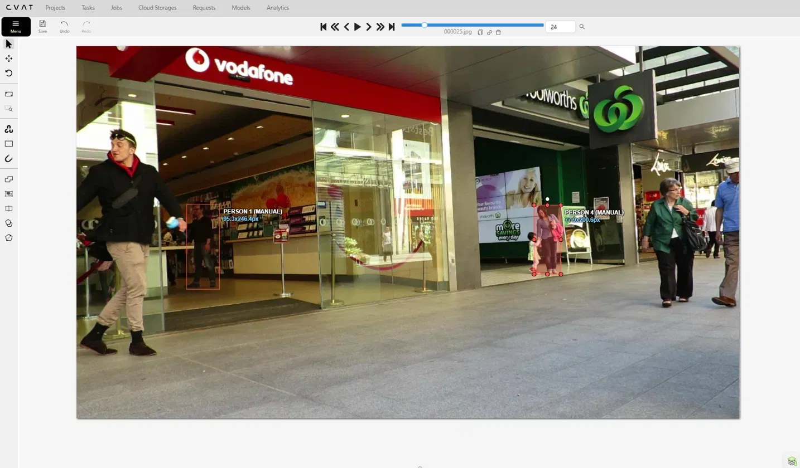
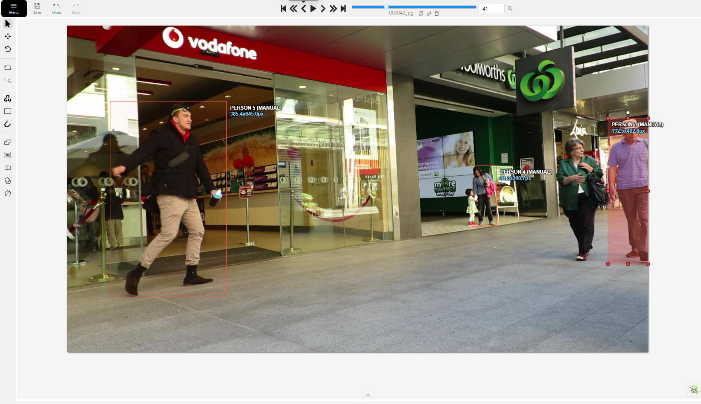
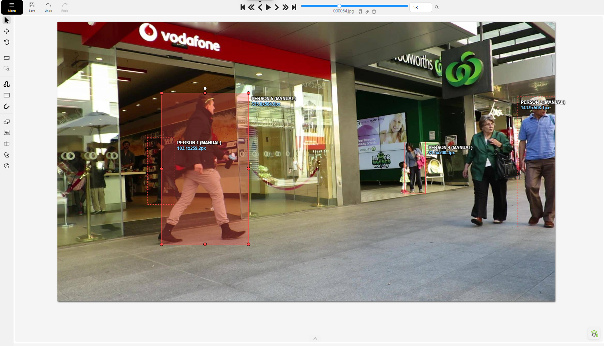

# Báo cáo cá nhân — NguyenThiHuongGiang-2A202603233


## 0. Thông tin học viên

- Họ tên: Nguyễn Thị Hương Giang
- MSSV: 2A202603233
- Mã đề (A/B/C): C
- Email: nthgiang0511@gmail.com
- Link repository: https://github.com/Giang0511/K5-L2-DAY05-NguyenThiHuongGiang-2A202603233-MOTTracking
- Giờ bắt đầu: 17h
- Giờ kết thúc: 19h

## 1. Xem trước đoạn video (CP0)

| Mã | Frame xuất hiện | Frame cuối thấy được | Rẽ / dừng / đổi tốc độ ở frame | Bị che ở frame | Ghi chú |
|---|---|---|---|---|---|
| P1 | 0 | 149 | Có đổi hướng đi quanh đoạn bị che (frame ~25–48) | 25–48 (bị P5 che; mất hẳn 41–48) | Người duy nhất có chỗ khó; đứng gần quầy, bị người đi ngang phía trước che |
| P2 | 60 | 149 | Frame 83 có đổi hướng | Không bị che | Xuất hiện muộn nhất |
| P3 | 39 | 149 | không có | Từ frame 39 đến 63 bị khuất một phần | Đi sát mép phải khung hình |
| P4 | 1 | 105 | Frame 24 dừng lại không di chuyển | Từ Frame 93 đến 105 bị khuất một phần do bị người áo xanh che | Ra khỏi khung sau frame 105 |
| P5 | 27 | 149 | không có | Từ frame 110 đến 119 bị khuất một phần, frame 120 đến 124 bị outsideoutside | Bị người áo xanh che một phần |

## 2. Keyframe và thời gian (CP1, CP4)

Số keyframe lấy từ kết quả `src/check_submission.py`.

| Mã | Số keyframe | Keyframe ở frame | Số frame có mặt | Keyframe / 100 frame | Thời gian (phút) | Chỗ khó |
|---|---:|---|---:|---:|---:|---|
| P1 | 25 | 0, 9, 19, 21, 23, 26, 28, 31, 49, 50, 54, 83, 84, 85, 86, 87, 88, 89, 106, 107, 108, 109, 122, 140, 144 | 142 | 17.6 | 20 | Bị che bởi P5 (frame 25–48), đổi hướng đi |
| P2 | 20 | 60, 61, 65, 66, 67, 68, 76, 79, 89, 101, 106, 110, 116, 121, 130, 139, 141, 142, 143, 146 | 90 | 22.2 | 20 | Không có chỗ khó đáng kể |
| P3 | 47 | 39, 40, 55, 56, 58, 59, 60, 61, 62, 70, 72, 73, 74, 75, 76, 77, 78, 79, 80, 91, 92, 93, 94, 95, 105, 106, 107, 108, 109, 110, 111, 112, 113, 122, 127, 128, 129, 130, 131, 132, 143, 144, 145, 146, 147, 148, 149 | 111 | 42.3 | 20 | Không có chỗ khó đáng kể |
| P4 | 5 | 1, 9, 37, 38, 97 | 105 | 4.8 | 20 | Không có chỗ khó đáng kể |
| P5 | 27 | 27, 39, 49, 50, 51, 52, 68, 77, 78, 79, 97, 105, 110, 119, 125, 126, 127, 128, 129, 130, 131, 132, 133, 134, 135, 136, 149 | 106 | 25.5 | 20 | Không có chỗ khó đáng kể |
| **Tổng** | **124** | | **554** | **22.4** | **100** | |

Keyframe / 100 frame của cả bài = tổng keyframe ÷ tổng số frame có mặt × 100 = 124 ÷ 554 × 100 = **22.4**.

Mỗi track mất khoảng 20 phút; thời gian còn lại của buổi dùng để review lại.

Bạn đặt keyframe nhiều nhất ở người nào? Vì sao (người đó rẽ, dừng, lại gần camera hay bị che)?

Nhiều nhất ở **P3** (47 keyframe, 42.3 keyframe / 100 frame, dưới ngưỡng cảnh báo 50). Do P3 đi sát mép phải khung hình, box to và đổi kích thước nhanh khi lại gần camera, cộng 31 frame `occluded`, nên nội suy tuyến tính dễ trôi; các frame 143–149 đặt keyframe từng frame vì người này đang ra khỏi khung.]

## 3. Đoạn bị che (CP2)

Người bị che: `P1`

| Mốc | Frame |
|---|---:|
| Bắt đầu bị che một phần (bật `occluded`) | 25 |
| Mất hẳn (bật `outside`) | 41 |
| Hiện lại (tắt `outside`) | 49 |
| Thấy rõ trở lại (tắt `occluded`) | 54 |

- Thời gian khuất hẳn: 8 frame (41–48) = 0,27 giây.
- Quyết định: **giữ cùng ID**.
- Lý do:
  1. Khuất hẳn chỉ 8 frame, ít hơn nhiều so với ngưỡng 60 frame (2 giây).
  2. Ngoại hình khớp: người mặc đồ tối màu, dáng và kích thước box (khoảng 95×246 px trước che, 103×258 px sau che) tương đương].
  3. Hướng đi có thay đổi so với trước khi bị che, nhưng vị trí hiện lại vẫn liền mạch với quỹ đạo cũ (P1 bị P5 đi ngang phía trước che), nên tôi xác nhận là cùng người và giữ cùng ID.





## 4. Tự review ID (CP3)

Đã thực hiện tự kiểm tra ID qua hai lượt:

Lượt 1: Kiểm tra theo từng người, đi ngược từ frame 149 về frame 0.

Lượt 2: Kiểm tra theo cảnh, nhảy từng 10 frame và quan sát cả 5 đối tượng.

Kết quả: Không phát hiện lỗi trong cả hai lượt kiểm tra. Sau khi hoàn thành, dữ liệu được lưu và chạy script tự kiểm tra.

| Frame | Mã người | Loại lỗi | Mô tả một câu | Phát hiện ở lượt | Đã sửa? |
|---:|---|---|---|---|---|
| Không có | P1 - P5 | không có lỗi | Đã kiểm hai lượt, không lỗi | Cả hai lượt | Không cần sửa |

Tổng hợp số lỗi theo loại:

| `id_switch` | `fragmentation` | `lost` | `merge` | `false_track` | `drift` | `flag` |
|---:|---:|---:|---:|---:|---:|---:|
| 0 | 0 | 0 | 0 | 0 | 0 | 0 |

Lỗi nào chỉ lượt 2 (theo cảnh) mới thấy, lượt 1 (theo người) không thấy? Vì sao?

Không có lỗi nào được ghi nhận. Nói chung, lượt 2 (theo cảnh) dễ thấy các lỗi liên quan giữa nhiều người như `merge` hoặc `false_track` (box thừa), còn lượt 1 (theo người) dễ thấy `drift` và `id_switch` của từng người.

## 5. File xuất và kết quả tự kiểm (CP4)

| Kiểm tra | Kết quả |
|---|---|
| Tên file MOT 1.1 | `NguyenThiHuongGiang_mot.zip` |
| Tên file CVAT for video 1.1 | `NguyenThiHuongGiang_cvat_video.zip` |
| Số track ID khác nhau trong `gt/gt.txt` (phải là 5) | 5 (tổng 554 box) |
| Frame `outside` không có dòng trong `gt.txt` (đúng / sai) | Đúng (P1 vắng 41–48; P5 vắng 120–124 và 137–148; P4 vắng sau frame 105) |
| Job đã completed trên CVAT máy cá nhân | Done |


```text
Số frame in theo CVAT (bắt đầu từ 0). Trong gt.txt, frame_id = frame CVAT + 1.

=== File MOT 1.1: NguyenThiHuongGiang_mot.zip ===
  Số track ID: 5   |   Tổng số box: 554
  [OK]        Đúng 5 track ID.

  Track | Frame có mặt | Số frame | Đoạn vắng (outside)
      1 |   0-149      |      142 | 41-48
      2 |   1-105      |      105 | -
      3 |  27-149      |      106 | 120-124, 137-148
      4 |  39-149      |      111 | -
      5 |  60-149      |       90 | -

=== File CVAT for video 1.1: NguyenThiHuongGiang_cvat_video.zip ===

  Track | Nhãn   | Frame thấy | Keyframe | KF/100 frame | Frame occluded | Lần bật outside
      0 | person |        142 |       25 |         17.6 |             46 |               1
      1 | person |         90 |       20 |         22.2 |              0 |               0
      2 | person |        111 |       47 |         42.3 |             31 |               0
      3 | person |        105 |        5 |          4.8 |              9 |               1
      4 | person |        106 |       27 |         25.5 |             35 |               2

  Tổng: 124 keyframe / 554 frame có mặt = 22.4 keyframe / 100 frame
  [OK]        Đọc được 5 track từ annotations.xml.

=== Tóm tắt ===
  Lỗi: 0   |   Cảnh báo: 0
  Đạt. Dán phần tóm tắt này vào báo cáo mục 5.
```

Kết luận tự kiểm: File MOT 1.1 và CVAT for video 1.1 được đọc thành công. Script xác nhận có đủ 5 track ID, tổng 554 box, 124 keyframe, không có lỗi và không có cảnh báo.

## 6. Ba câu kết

1. Nếu được gán lại, bạn sẽ đặt keyframe khác ở đâu? Vì sao?

   Tôi sẽ đặt keyframe tập trung hơn ở những đoạn đổi hướng, đổi tốc độ và đổi kích thước, và kiểm tra kỹ nội suy giữa hai keyframe để box không trôi khỏi người. Cụ thể, P3 đang có 47 keyframe (42.3 / 100 frame), nhiều đoạn đặt liên tiếp từng frame, tôi sẽ thưa bớt ở những đoạn nội suy đã đủ tốt. Ngược lại P4 chỉ có 5 keyframe (4.8 / 100 frame, thấp hơn mức tham khảo 8–18), tôi sẽ thêm keyframe mỗi 20–30 frame để chắc box luôn bám sát toàn thân.

2. Có chỗ nào bạn không chắc "cùng ID hay ID mới"? Bạn đã quyết định và ghi chú thế nào?

   Có. Tôi phân vân ở P4 và P5, khi hai người này bị người áo xanh đi ngang che khuất: nên đánh cùng ID hay ID mới. Tôi áp dụng ba câu hỏi của guideline: thời gian khuất ngắn (P5 chỉ `outside` 5 frame, 120–124, rất xa ngưỡng 60 frame), ngoại hình không đổi, và vị trí hiện lại liền mạch với hướng đi cũ. Vì vậy tôi giữ **cùng ID**, dùng `occluded` cho đoạn che một phần và `outside` cho đoạn mất hẳn, không tạo track mới. Kết quả là mỗi người vẫn chỉ có một track và script xác nhận đúng 5 track ID.

3. Một lỗi ID trong job của bạn (nếu không còn sót, chọn lỗi đã sửa) có thể làm xe tự lái dự đoán sai chuyển động của người đó như thế nào? Lỗi đó ảnh hưởng MOTA hay IDF1 nhiều hơn?

   Job của tôi không còn lỗi sót nên tôi lấy ví dụ giả định là `id_switch` ở đoạn P1 bị P5 che. Nếu ID của P1 nhảy sang P5, vị trí và vận tốc của người này bị gán cho người kia; vị trí nhảy hàng mét trong 1/30 giây sẽ cho vận tốc phi thực tế (1,5 m trong 1/30 giây ≈ 162 km/h), khiến xe dự đoán sai quỹ đạo và có thể phanh hoặc tránh sai. Lỗi này ảnh hưởng **IDF1 nhiều hơn**, vì IDF1 đo khả năng giữ đúng danh tính suốt quỹ đạo, và một lần đổi ID làm sai phần còn lại của track. Với MOTA, một `id_switch` chỉ được đếm là một sự kiện.


## 7. Tài liệu tham khảo và công cụ AI đã dùng

- ChatGPT, Claude — Hỗ trợ giải thích hướng dẫn, kiểm tra kết quả script và soạn thảo báo cáo.
